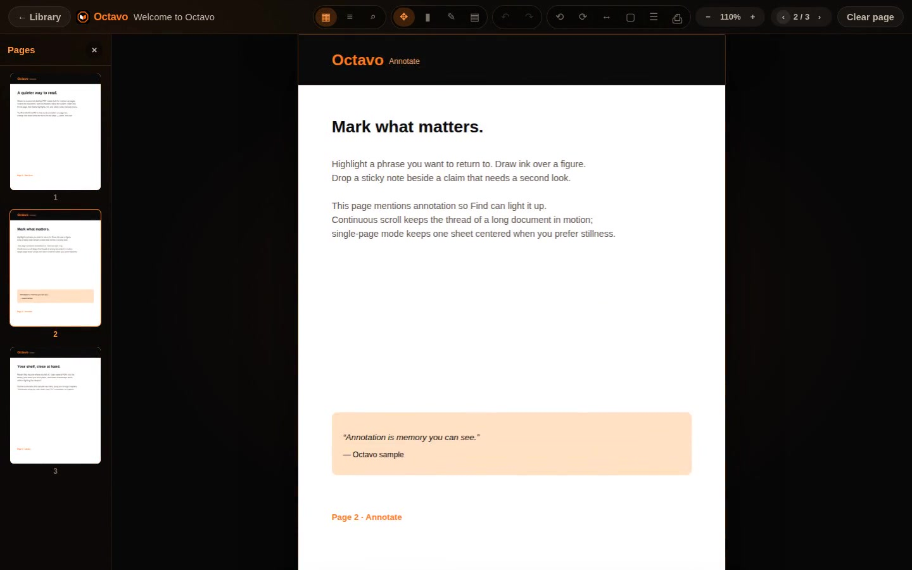

# Octavo

[](https://github.com/nmofonseca/octavo/actions/workflows/test.yml)
[](https://github.com/nmofonseca/octavo/actions/workflows/desktop-build.yml)
[&label=Linux%20amd64)](https://github.com/nmofonseca/octavo/actions/workflows/desktop-build.yml)
[&label=Linux%20arm64)](https://github.com/nmofonseca/octavo/actions/workflows/desktop-build.yml)
[&label=Windows%20amd64)](https://github.com/nmofonseca/octavo/actions/workflows/desktop-build.yml)
[&label=Windows%20arm64)](https://github.com/nmofonseca/octavo/actions/workflows/desktop-build.yml)

A personal, multi-platform desktop PDF reader with annotations — highlights, freehand ink, and sticky notes — built for calm, brand-first reading in an **orange + black** palette.

**Stack:** [Tauri 2](https://tauri.app) + React + Vite + [PDF.js](https://mozilla.github.io/pdf.js/)

## Feature demo

Web UI walkthrough (library → sample PDF → pages / outline → find → highlight / ink / sticky note → rotate / fit / zoom → view mode → back to library), recorded on a cloud agent VM with Playwright (~31s, 1440×900):

[](docs/media/octavo-features-demo.mp4)

[Watch / download the MP4](docs/media/octavo-features-demo.mp4) · re-record: `npm run dev` then `node tools/record-features-demo.mjs`.

## ✨ Features (v1)

- Open local PDFs (or the bundled sample) with a **recent library** and resume
- **Find in document** (Ctrl/Cmd+F) with next/prev, match count, and hit highlights
- **Page thumbnails** and **outline/bookmarks** sidebar (when the PDF has a TOC)
- **Rotate** view, **fit width / fit page**, zoom presets
- **Continuous scroll** or **single-page** mode
- **Print** via the system dialog
- Pan/zoom, page navigation
- Highlight regions, freehand ink, sticky notes (persisted per document)

## 🛠️ Run (development)

### Prerequisites

- Node.js 20+
- Rust stable (for the desktop shell)
- Linux: WebKitGTK 4.1 + GTK 3 (see [Tauri Linux prerequisites](https://tauri.app/start/prerequisites/))
- Windows: WebView2 (usually preinstalled on Win10/11)

### Web UI only (fast demos)

```bash
npm install
npm run dev
```

Open the printed `http://localhost:1420` URL. Sample PDF: `public/samples/octavo-welcome.pdf`.

### Desktop shell (Tauri)

```bash
npm install
npm run tauri:dev
```

## 📦 Install (releases)

After each successful desktop build on `main`, CI publishes a [GitHub Release](https://github.com/nmofonseca/octavo/releases) tagged `v{GitVersion}` with installers for **Linux and Windows × amd64 and arm64**.

### Ubuntu / Debian

Prefer the **`.deb`** from the latest release (amd64 or arm64 to match your CPU):

```bash
sudo apt install ./Octavo_*_amd64.deb   # or *_arm64.deb
```

The **AppImage** also works on Ubuntu/Debian if you want a portable binary (no package install):

```bash
chmod +x Octavo_*.AppImage
./Octavo_*.AppImage
```

### Linux AppImage (any distro)

Prefer the **AppImage** when you want a portable binary without a package manager. Download manually, or use the XDG installer (upgrade / roll back included):

```bash
./tools/install-appimage.sh              # latest → ~/.local/share/Octavo/ + launcher
./tools/install-appimage.sh update       # upgrade existing install to latest
./tools/install-appimage.sh --version 0.2.12   # install or roll back to a tag
```

See [`tools/README.md`](tools/README.md). Manual:

```bash
chmod +x Octavo_*.AppImage
./Octavo_*.AppImage
```

A FUSE 2 runtime may be required depending on your distro’s AppImage support.

### Fedora / RHEL-like (bonus)

CI also builds **`.rpm`** when the Linux bundler runs. Use that on rpm-based distros; Arch/CachyOS should still prefer AppImage (or a future AUR package), not the `.rpm`.

### Windows

Download the **`.msi`** (WiX) and/or **`-setup.exe`** (NSIS) for your arch (`x64` / `arm64`) from the release and run the installer. WebView2 is required (usually preinstalled on Windows 10/11).

### Artifact names

| Platform | Arch | Formats | Typical filenames |
| --- | --- | --- | --- |
| Linux | amd64 | AppImage, `.deb`, `.rpm` | `Octavo_<ver>_amd64.AppImage`, `Octavo_<ver>_amd64.deb`, `Octavo-<ver>-1.x86_64.rpm` |
| Linux | arm64 | AppImage, `.deb`, `.rpm` | `Octavo_<ver>_arm64.AppImage`, `Octavo_<ver>_arm64.deb`, `Octavo-<ver>-1.arm64.rpm` |
| Windows | amd64 | `.msi`, NSIS `.exe` | `Octavo_<ver>_x64_en-US.msi`, `Octavo_<ver>_x64-setup.exe` |
| Windows | arm64 | `.msi`, NSIS `.exe` | `Octavo_<ver>_arm64_en-US.msi`, `Octavo_<ver>_arm64-setup.exe` |

`<ver>` is the stamped semver. CI renames Tauri’s Linux ARM AppImage/rpm `aarch64` labels to **`arm64`** before publishing so ARM assets match `.deb` and Windows.

## 🧰 Packaging notes (local)

```bash
npm run tauri:build
```

Configured bundle targets: **`appimage`**, **`deb`**, **`rpm`**, **`msi`**, **`nsis`**. Artifacts land under `src-tauri/target/release/bundle/`. Prefer native CI runners per OS/arch. Icons live in `src-tauri/icons/`.

## 🚦 CI / versioning

| Workflow | Trigger | Required / notes |
| --- | --- | --- |
| `test` (job `test`) | PRs + pushes to `main` | **Required** — keep job name `test` for the Protect main ruleset |
| `desktop-build` → `build (*)` | Push to `main` only | Optional checks: `build (ubuntu-22.04)`, `build (ubuntu-24.04-arm)`, `build (windows-latest)`, `build (windows-11-arm)` |
| `desktop-build` → `github-release` | After all `build` jobs succeed | Soft-creates tag `v{semVer}` (no force) + `gh release create` with the installers above; only this job has `contents: write` |

Local quality gates:

```bash
npm run lint
npm run typecheck
npm test
npm run build
```

Semver comes from [GitVersion](https://gitversion.net/) (`GitVersion.yml`). CI stamps `package.json`, `src-tauri/tauri.conf.json`, and `src-tauri/Cargo.toml` via `npm run version:apply -- <semver> [majorMinorPatch]`. The library UI shows `v{version}` from `package.json`. Release tags are soft-created from that semver after desktop builds succeed.

## 📝 Annotation storage

Annotation JSON lives in the webview’s `localStorage`, keyed by document id. Packaged builds inherit the OS WebView storage for the app origin.

## ⌨️ Keyboard

| Key | Action |
| --- | --- |
| Ctrl/Cmd+F | Find in document |
| Enter / Shift+Enter (in Find) | Next / previous match |
| Ctrl/Cmd+P | Print |
| ← / → or j / k | Prev / next page |
| + / − | Zoom |
| f / F | Fit width / fit page |
| r / R | Rotate CW / CCW |
| 1–4 | Pan / Highlight / Ink / Note |
| Esc | Close find, or back to library |

## 📄 License

Private / personal use unless otherwise stated.
